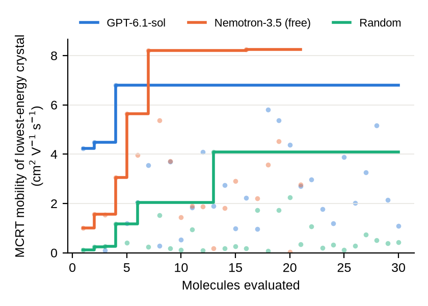

# Azapentacene mobility agent

An LLM agent that searches a fixed chemical space (aza-substituted five-ring catacondensed acenes) for molecules
whose predicted crystal has high charge mobility. It was built as a compact winter-school project, so the physics
is deliberately simplified (see [Simplifications](#simplifications-and-caveats)).

Each turn the agent **reads** the results table, **selects** one new molecule, **calls** the evaluation tool and
the result is **written** back to the table. The table is the agent's only memory, so a campaign can be stopped and
resumed at any time.

```
             +-------------------- results table (molecules.csv) + notebook.md <------------------+
             |                                                                                    |
             v                                                                                    |
   LLM agent (OpenAI or OpenRouter)  --evaluate_candidate(skeleton, sites)-->  duplicate / space gate
                                                                                      |
                                                                                      v
   Clari-H CSP: 2 x N draws (Z = 2, 4)  ->  overlap + bond-graph QC  ->  [optional quick MACE relax + QC again]
                                                                                      |
                                                                                      v
              MACE-OFF23-small single points (float64)  ->  lowest-energy crystal  ->  MCRT mobility  --+
```

## Chemical space

* Ten unbranched catacondensed five-ring skeletons. The skeleton code gives the annelation of the three inner
  rings: `L` linear, `A`/`B` angular with the same/opposite turn. `LLL` is pentacene, `ABA` picene,
  `AAA` [5]helicene, and so on.
* Each skeleton has 14 C-H sites, numbered around the perimeter. A candidate is `skeleton:sites`, for example
  `LLL:6-13`, meaning N at sites 6 and 13.
* Gate: the original AlphaPack RDKit rules (`aza_agent/azapentacene_space.py`, unchanged), at least one N, neutral,
  no radicals.
* Duplicates are rejected by graph key or aromatic key. This covers both the reference set of known
  azapentacenes and molecules already tested in the campaign (symmetry-equivalent site sets are the same molecule).
  Rejected proposals do not use budget.

## Evaluation pipeline (one molecule)

| stage | what happens | where |
|---|---|---|
| CSP | Clari-H draws `samples_per_z` crystals for Z = 2 and 4. Seeds are deterministic per molecule and Z. | in process (`pipeline.py`) |
| QC | Severe overlap (< 0.6 x sum of covalent radii, H included): `skipped_severe_overlap`. Wrong molecule count or bond graph: `broken_molecule`. Skipped draws stay in the denominator. | `qc.py`, `crystal_geometry_qc.py` |
| relax (optional) | ASE LBFGS on cell + positions, <= `--relax-steps`, fmax 0.05, float32, 4 GPU workers. Afterwards the same overlap and bond-graph checks are repeated; any change counts as a relax failure. | `workers/mace_worker.py` |
| energy | MACE-OFF23-small single points, float64. E_latt = E_crys/Z - E(gas, MACE-optimised). It splits into E_inter (frozen packing) + strain. | `workers/mace_worker.py` |
| mobility | MCRT (Jay mobility fine-tune) on the lowest-energy crystal and on others within 7.2 kJ/mol (at most 10). | `workers/mcrt_worker.py` |

The objective is `mu_lowestE`, the MCRT mobility of the lowest-energy crystal. `mu_mean_window` is also recorded.

The three models need incompatible environments, so MACE and MCRT run as persistent JSON-lines worker processes
(`workers/client.py`). Each model is loaded once per campaign.

## Agent and tools

| tool | cost | purpose |
|---|---|---|
| `check_candidate` | free | validity / novelty check of a skeleton+sites or SMILES |
| `get_crystals` | free | crystal-level rows of an evaluated molecule (energies, cell, mobility) |
| `evaluate_candidate` | one unit of budget | full pipeline; requires a rationale and an updated research notebook |

* **OpenAI** (`--provider openai`, default): Responses API with function tools (`llm.py`, stdlib only).
* **OpenRouter** (`--provider openrouter`): Chat Completions with the same tools. This is meant for free models.
  Free-tier keys allow 50 requests per day, so the default *frugal* mode offers only `evaluate_candidate`; a rejected
  duplicate comes back with a few novel candidates one edit away. `nvidia/nemotron-3.5-super-vl:free` worked best
  among the free models tested (about 6 s per request, reliable tool calls).
* **Random baseline** (`--policy random`): uniform skeleton, 1-12 N, random sites. `--random-skeletons LLL`
  restricts it to chosen skeletons, which makes a fairer baseline for an agent that already knows pentacene is good.

## Setup

Three Python environments are used (none ships with this repository):

| role | needs | config variable |
|---|---|---|
| orchestrator | Clari-H checkout + its env, RDKit, pandas, networkx, ASE, pymatgen, matplotlib | run with this python (`AZA_PY` in scripts), `AZA_CLARI_ROOT` |
| MACE worker | mace-torch, ASE, pymatgen | `AZA_MACE_PY` |
| MCRT worker | MCRT source + fine-tuned checkpoint inside an apptainer image | `AZA_MCRT_SIF`, `AZA_MCRT_ROOT`, `AZA_MCRT_CKPT`, `AZA_APPTAINER` |

All locations are in [`aza_agent/config.py`](aza_agent/config.py) and can be overridden by environment variables.
The defaults are the paths on the development machine.

* **Reference set:** the duplicate gate needs the reference CSV of known azapentacenes (column `Bonded_SMILES`) at
  `data/mobility_xyz_bonded_from_inchi.csv`, or wherever `AZA_KNOWN_CSV` points. It is not included here.
* **API keys:** read from a file, never from the code. Defaults: `OPENAI_API_KEY_FILE`, and
  `OPENROUTER_API_KEY_FILE` (`~/.config/openrouter_api_key`). `OPENAI_API_KEY` / `OPENROUTER_API_KEY` also work.
  Keep key files private (`chmod 600`).

## Usage

```bash
cd projects/azapentacene_mobility
PY=/path/to/orchestrator/python

# GPT agent, 30 molecules, 64 draws per Z, no relaxation (the winter-school setting)
$PY -m aza_agent.campaign init --dir campaigns/gpt --policy llm --budget 30
# free model through OpenRouter, with quick relaxation and 50 draws per Z
$PY -m aza_agent.campaign init --dir campaigns/free --policy llm --provider openrouter \
    --model nvidia/nemotron-3.5-super-vl:free --samples-per-z 50 --relax-steps 100
# random baselines
$PY -m aza_agent.campaign init --dir campaigns/rand --policy random
$PY -m aza_agent.campaign init --dir campaigns/randLLL --policy random --random-skeletons LLL

$PY -m aza_agent.campaign run --dir campaigns/gpt          # resumable: rerun to continue
$PY -m aza_agent.campaign report --dir campaigns/gpt       # ranked table
$PY -m aza_agent.campaign retry-failed --dir campaigns/gpt # rerun pipeline errors in place (originals kept)
$PY -m aza_agent.plot best.png campaigns/gpt:GPT campaigns/rand:Random   # best-so-far plot (linear y)
```

Other `init` options: `--goal` (free text placed in the system prompt), `--model`, `--effort`, `--z`,
`--rank-energy {total,inter}`, `--relax-fixed-cell`, `--relax-dtype`, `--relax-workers`, `--gpu`, `--seed`.
`scripts/` has the batch runs used for the demo: LLM vs random, the relaxed three-arm comparison, and
`run_replicates.sh ARM GPU SEED...` for independent replicates (ARM = gpt | random | nemotron).

### Outputs of a campaign directory

| file | content |
|---|---|
| `campaign.json` | all settings (policy, model, pipeline config) |
| `molecules.csv` | one row per evaluated molecule: label, objective, energies, QC counts, timings, agent rationale |
| `crystals.csv` | one row per Clari draw (including skipped / broken / relax-failed): status, reason, energies, cell, mobility |
| `proposals.csv` | every proposal, including free checks and rejected duplicates |
| `notebook.md`, `agent_log.jsonl`, `ledger.jsonl` | agent notes, tool calls, token usage per request |
| `structures/Mxxxx/` | `raw_cifs.zip` and `relaxed_cifs.zip` (all draws, verified), lowest-energy CIF, `summary.json` |

## Simplifications and caveats

* **Without relaxation, "lowest energy" is unreliable.** Clari structures carry distorted molecules. In unrelaxed
  structures, strain relative to the relaxed gas molecule is 40-235 kJ/mol and dominates the total energy, so the
  lowest-energy draw is mostly the least distorted one. In a benchmark on three molecules (100 draws each):
  * the Spearman correlation between unrelaxed and relaxed energies was only 0.2-0.5;
  * after a quick relax the minimum was a different crystal in every case;
  * its mobility dropped, for example 6.80 -> 1.00 and 4.08 -> 1.83.

  `--relax-steps 100` (about +2 min per molecule on an L4) addresses this; after it, strain falls to a few kJ/mol.
* **LLM prior knowledge.** The agent sees no mobility labels of known molecules. It still starts high because it
  knows from chemistry and the literature that linear pentacenes are good. In the MCRT reference labels, `LLL`
  molecules have a median mobility of 4.4, against < 1 for most other skeletons. Compare against
  `--random-skeletons LLL` and use several seeds before claiming that the loop itself helps.
* MCRT is a surrogate trained on CSP landscapes of known azapentacenes; predictions for new molecules are
  extrapolations.

## Demo results (viz1, one seed, unrelaxed objective)

| arm | molecules | best mu_lowestE | median | mu >= 3 | LLL share |
|---|---|---|---|---|---|
| GPT-6.1-sol (OpenAI) | 30 | 6.80 | 2.46 | 12 | 27/30 |
| Nemotron-3.5-super (OpenRouter, free) | 21 (daily request limit) | 8.25 | 2.76 | 9 | 19/21 |
| Random | 30 | 4.08 | 0.33 | 1 | 2/30 |



Timing on an NVIDIA L4: about 1 min per molecule without relaxation (128 draws), and about 3 min with the quick
relax (100 draws). The LLM adds 5-60 s per turn, depending on the model.

## Layout

```
aza_agent/
  config.py               machine-specific paths (environment overrides)
  space.py                skeletons, site numbering, gate, duplicate keys
  azapentacene_space.py   original AlphaPack RDKit rules (unchanged)
  qc.py                   overlap gate + bond-graph integrity / unwrapping
  crystal_geometry_qc.py  periodic severe-overlap check (unchanged copy of clari/scripts/crystal_geometry_qc.py)
  pipeline.py             Toolbox: Clari + MACE worker + MCRT worker; evaluate(smiles)
  campaign.py             agent loop, tools, random baseline, CLI
  llm.py                  OpenAI Responses + OpenRouter Chat Completions clients
  plot.py                 best-so-far plot
  bench_relax*.py         relaxation timing / effect benchmark
  workers/                client + MACE and MCRT worker processes
scripts/                  demo batch runs
tests/test_space.py       CPU-only checks of the space and gate
```
